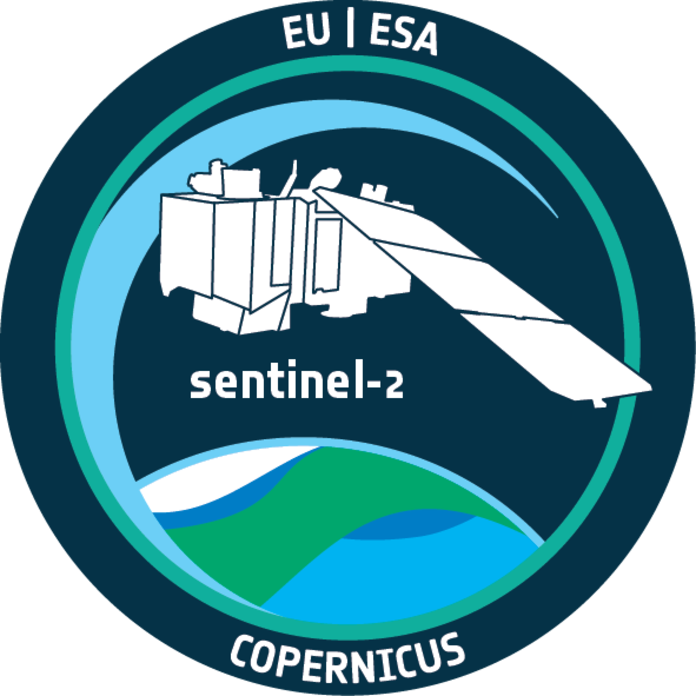
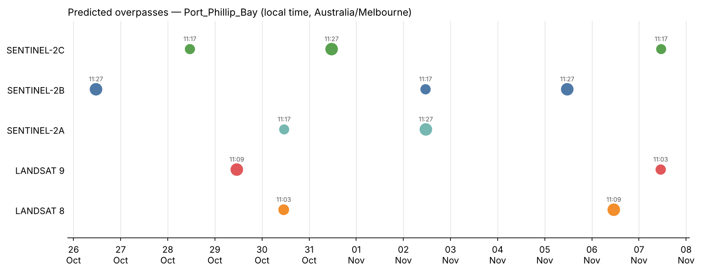
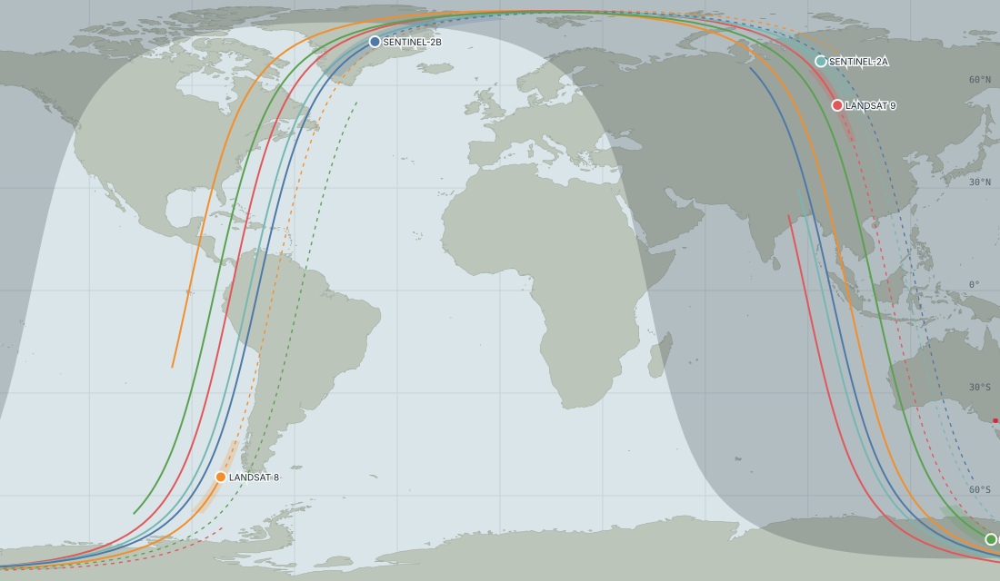

# 🧑‍💻 eo-overpass-predictor

<table align="right">
  <tr>
    <td align="center">
      <a href="https://www.esa.int/Applications/Observing_the_Earth/Copernicus/Sentinel-2" target="_blank">
        
      </a>
      <br>
      <b>👤 Julian Manning</b>
      <br>
      <sub>♻️ Last updated: <b>October 2026</b></sub>
      <br>
      <sub>📝 <b>Landsat / Sentinel-2 Overpass Workflow</b></sub>
      <br>
      <sub>📧 <a href="mailto:julian.manning@outlook.com">julian.manning@outlook.com</a></sub>
      <br>
      <sub>🔗 Connect on <a href="https://www.linkedin.com/in/julian-manning/">LinkedIn</a></sub>
    </td>
  </tr>
</table>


A notebook-driven Python toolkit that tells you **when Landsat 8/9 and Sentinel-2A/B/C will image your Region of Interest**. It propagates current orbital elements with SGP4, intersects each satellite's **instrument swath** with your ROI, and reports every overpass in **UTC and in the ROI's own local time** (DST-aware) as CSV. It also provides an n2yo-style **live tracker**, both inside Jupyter and as a standalone web page, and an optional cross-check against **ESA's published Sentinel-2 acquisition plans**.


<br clear="right">

---

## 🛰️ The Problem: "Above the Horizon" Is Not "Over My Site"

General-purpose trackers such as [n2yo.com](https://www.n2yo.com/) answer *when is this satellite visible from here?* For a sun-synchronous Earth-observation satellite, that is true several times a day — on passes hundreds of kilometres to either side, at night, or on the ascending node when the optical sensor is off. None of that tells you whether your study area will be in the next scene.

Field campaigns, in-situ validation (water quality sampling, spectroradiometry, drone flights), and tasking decisions need a different answer: **on which date and at what local time will the instrument footprint cover my ROI, and how much of it?**

This repository answers that question geometrically and, for Sentinel-2, against the mission plan.

---

## ⚡ Core Features

As with the companion [CDSE download pipelines](#-related), this is a transparent **Clone-and-Run Toolkit**: sequential Jupyter notebooks over one documented helper module, rather than a black-box package.

* **Swath-Aware Overpass Prediction**: SGP4 propagation (Skyfield) with a 30 s coarse scan and 1 s refinement. Cross-track scan lines (MSI ≈ 290 km, OLI ≈ 185 km) are built geodesically from the ground-track heading and intersected with the ROI in an **ROI-centred Lambert equal-area projection**, giving ROI entry/exit times, the closest-approach (scene-centre) time, and the true **% of the ROI imaged**.
* **Acquisition Realism**: Keeps only **daytime descending** passes inside each mission's latitude limits by default. Every pass carries direction, nadir offset, side of track, view angle, an **edge margin** that flags marginal swath-edge passes, solar elevation, and TLE age.
* **ESA Plan Cross-Check (Sentinel-2)**: Downloads ESA's acquisition-plan KMLs for the prediction window and labels each Sentinel-2 pass *planned (NOMINAL)*, *not planned* or *no plan loaded*. This matters because **Sentinel-2A runs an extension campaign to 31 Dec 2026 that acquires selected regions only**, and Sentinel-2 does not acquire open ocean.
* **Local-Time Intelligence**: The ROI's IANA zone (e.g. `Australia/Melbourne`) is resolved offline from its location, so each pass is converted with the offset in force *on that date*, across daylight-saving changes.
* **Flexible ROI Input**: Any vector file in any CRS, a shapely geometry or WKT, a `(lon, lat)` point, or a bounding box. An optional buffer captures scenes that only clip the edge.
* **Resilient TLE Retrieval**: CelesTrak GP with a mirror fallback, a 12-hour on-disk cache, offline use of the last cache, and paste-in TLEs (column spacing collapsed by web pages is rebuilt and checksum-verified).
* **Reporting**: Summary tables, an n2yo-style next-pass countdown, Esri footprint maps, a pass timeline chart, **CSV** (UTC + local ISO-8601 with explicit offsets) and **GeoPackage** footprints for QGIS/ArcGIS.
* **Live View, Two Ways**: an **ipyleaflet tracker** in Jupyter (positions, past/future ground tracks, live swath, day/night terminator, UTC and ROI-local clocks, countdown), and a **standalone HTML tracker** that propagates the orbits in the browser — no Python needed to view or share it.
* **Turnkey Environment**: The same Conda/Jupyter environment builder as the CDSE pipelines.

---

## 🗺️ Example Output

Predicted imaging overpasses of a Port Phillip Bay ROI (Victoria, Australia), 24 Oct – 8 Nov 2026, from `p01_overpass_prediction.ipynb`. Marker size scales with ROI coverage; labels are local time (AEDT). Sentinel-2B and 2C fall 5 days apart and each repeats every 10 days; Landsat 8 and 9 are 8 days apart.



The standalone live tracker (`OUTPUT/live_tracker.html`) in world view: current positions, last 45 min (dashed) and next 90 min (solid) of ground track, live swaths, and the night side.



A sample report is in [`Example/CSV/overpasses_Port_Phillip_Bay_example.csv`](Example/CSV/overpasses_Port_Phillip_Bay_example.csv).

> 📌 **Interactive maps on GitHub**: Folium and ipyleaflet outputs are HTML/JavaScript, which GitHub's notebook preview does not execute. They are fully interactive when the notebooks run locally, and the footprint map can be exported with `save_path`.

---

## ✅ Validation Against Real Acquisitions

Back-predictions over south-east Australia were compared with acquisition times of delivered products (USGS Collection 2 scene-centre times and Sentinel-2 L2A granule times, via the Earth Search STAC API). A point ROI was placed at each scene's centroid.

| Satellite | Product | Observed (UTC) | Predicted − observed | TLE epoch → pass |
| :--- | :--- | :--- | :--- | :--- |
| Landsat 9 | LC09 093/086, 13 Oct 2026 | 00:09:46.6 | **+0.3 s** | −6 d |
| Landsat 9 | LC09 092/087, 6 Oct 2026 | 00:03:58.8 | **+0.1 s** | −13 d |
| Landsat 9 | LC09 087/070, 18 Oct 2026 | 23:26:17.9 | **< 1 s** | 0 d |
| Sentinel-2B | T55HCU, 23 Oct 2026 | 00:17:22.2 | **+0.7 s** | +2 d |
| Sentinel-2B | T55HBU, 23 Oct 2026 (swath-edge sliver) | 00:17:29.6 | **+0.2 s**, edge margin 1.5 km | +2 d |
| Sentinel-2B | T55HCU, same pass, **23-day-old TLE** | 00:17:22.2 | −12.5 s | +23 d |
| Landsat 8 | LC08 092/087, 14 Oct 2026 | 00:03:53.9 | −9.0 s | −9 d |

What this shows:

* **With fresh TLEs, timing is within about a second** and the swath geometry correctly includes a tile that was only clipped at the swath edge.
* **TLE age is the main error source.** The same Sentinel-2B pass drifted to −12.5 s with a 23-day-old element set, and Landsat 8 drifted about 1 s per day when propagated backwards across what appears to be an orbit-maintenance manoeuvre. Refresh TLEs (the default 12 h cache does this) and re-run before relying on predictions more than about two weeks ahead.
* **Swath edges are uncertain by a few kilometres.** The nominal widths are used, and the real edge varies with altitude and detector layout. Passes with `edge_margin_km` within about ±5 km of zero should be treated as possible rather than certain.

---

## 📂 Repository Structure

```text
eo-overpass-predictor/
│
├── p00_overpass_env_setup.ipynb       # Step 0: Turnkey workspace & kernel initialisation
├── p01_overpass_prediction.ipynb      # Step 1: ROI → TLEs → swath-aware prediction → ESA plan check → CSV
├── p02_overpass_live_tracker.ipynb    # Step 2: Live ipyleaflet tracker + standalone HTML tracker
│
├── DATA/
│   ├── SHP/                           # Your ROI vector files (example: Port Phillip Bay, EPSG:32755)
│   ├── TLE/                           # Cached orbital elements (auto-refreshed, ignored by git)
│   └── KML/                           # Cached ESA Sentinel-2 acquisition plans (ignored by git)
│
├── OUTPUT/                            # CSV reports, GeoPackage footprints, live_tracker.html (ignored by git)
│
├── Tools/
│   ├── env.base.yml                   # Conda environment definition (conda-forge)
│   ├── overpass_env_builder.py        # Conda & Jupyter lifecycle automation
│   ├── overpass_helper_utility.py     # TLEs, propagation, swath intersection, time zones, plans, reports, live view
│   ├── live_tracker_template.html     # Standalone tracker page template (satellite.js, canvas)
│   └── world_land_50m.json            # Natural Earth 1:50m land, compacted for the standalone tracker
│
└── Example/
    ├── CSV/                           # Sample overpass report
    └── IMG/                           # Images used in this README
```

## 🚀 Execution Workflow

### Step 0: Workspace Initialisation
Open and execute `p00_overpass_env_setup.ipynb`. It builds the `overpass` Conda environment from `Tools/env.base.yml` (conda-forge), registers the **`Python (Overpass)`** kernel, and audits the kernel-to-environment mapping.

### Step 1: Overpass Prediction & Report
Open `p01_overpass_prediction.ipynb` with the `Python (Overpass)` kernel.

* Point `ROI_SHP_PATH` at your study area (any CRS), or pass a point or bounding box to `load_roi`.
* Check the resolved time zone. Override it if the ROI spans zones.
* Fetch TLEs. The cache is reused for 12 h; paste your own with `tle_text=` if needed.
* Set `prediction_config`: window start and length (`days=16` by default), daytime-descending filter, minimum ROI coverage, satellite subset.
* Run the prediction, then review the summary table, countdown, footprint map and timeline.
* Optionally cross-check Sentinel-2 passes against ESA's acquisition plans.
* Export the CSV, GeoPackage and live-tracker page to `OUTPUT/`.

### Step 2: Live View
Open `p02_overpass_live_tracker.ipynb`. Run the tracker cell for a live ipyleaflet map that updates every 2 s and leaves the notebook usable; stop it with the **Live** toggle or `TRACKER.stop()`. Export the standalone page to watch or share the live view in any browser.

---

## 📋 CSV Report Columns

| Column | Meaning |
| :--- | :--- |
| `satellite`, `mission`, `sensor`, `norad_id` | Which satellite and instrument. |
| `direction`, `imaging_expected` | Ascending/descending, and whether optical imaging is expected (descending, sunlit, inside latitude limits). |
| `roi_coverage_pct` | Share of the ROI area inside the swath on this pass. |
| `roi_entry_utc`, `overpass_utc`, `roi_exit_utc` | Swath first touches the ROI / closest approach to the ROI anchor (≈ scene centre) / swath leaves the ROI. ISO-8601, `Z`. |
| `roi_entry_local`, `overpass_local`, `roi_exit_local` | The same instants in local time with explicit offset, e.g. `2026-10-26T11:27:30+11:00`. |
| `local_date`, `local_time`, `local_weekday`, `timezone`, `utc_offset` | Spreadsheet-friendly local fields. |
| `nadir_offset_km`, `roi_side_of_track`, `edge_margin_km`, `view_angle_deg` | Imaging geometry at the ROI anchor. |
| `max_elevation_deg` | Satellite elevation seen from the ROI (n2yo's "max elevation"). |
| `sun_elevation_deg`, `sat_altitude_km` | Illumination and orbit altitude at overpass. |
| `tle_epoch_utc`, `tle_age_days` | Element set used and its distance in time from the pass. |
| `esa_plan_status`, `esa_datatake_id`, `esa_relative_orbit` | Present after the Sentinel-2 plan cross-check. |

---

## ⚠️ Scope & Limitations

* **Geometry, not guarantees.** A predicted pass means the sensor footprint covers the ROI. Delivery also depends on the mission plan, downlink and processing. Cloud cover is not forecast.
* **Landsat plans are not cross-checked.** USGS acquires essentially all daytime land and near-coastal WRS-2 scenes but publishes no machine-readable plan comparable to ESA's.
* **Sentinel-2A** is in a temporary extension campaign (to 31 Dec 2026) with regional coverage only. Treat its geometric passes as candidates until the ESA plan confirms them.
* **Nadir-looking optical sensors only.** The swath model is centred on the ground track. Side-looking SAR (e.g. Sentinel-1) would need an offset swath model; add an entry to `SATELLITE_CATALOGUE` only for nadir-centred instruments.
* **Network access** to `celestrak.org` (or the TLE mirror) and, for the plan check, `sentinels.copernicus.eu` is needed at run time. The standalone tracker loads `satellite.js` from jsDelivr.

## 📋 Requirements
* An existing installation of Miniconda / Anaconda.
* Python 3.11 (built by `p00`). Key libraries: Skyfield (SGP4), GeoPandas/Shapely 2, pyproj, timezonefinder, Folium, ipyleaflet.
* No account is needed: TLEs, ESA plans and the tracker's dependencies are public.

## 🔗 Related
* **[cdse-sentinel2-pipeline](https://github.com/julianManning/cdse-sentinel2-pipeline)** ([DOI: 10.5281/zenodo.23598342](https://doi.org/10.5281/zenodo.23598342)) — download the Sentinel-2 scenes once they are acquired.
* **[cdse-sentinel1-pipeline](https://github.com/julianManning/cdse-sentinel1-pipeline)** ([DOI: 10.5281/zenodo.23595216](https://doi.org/10.5281/zenodo.23595216)) — the companion workflow for Sentinel-1 SAR.

## 📚 Citation & Data Attribution
* **Citing this software**: use **"Cite this repository"** in the GitHub sidebar (generated from `CITATION.cff`).
* **Orbital elements**: TLEs courtesy of [CelesTrak](https://celestrak.org/) (data from the US Space Force 18th/19th Space Defense Squadrons via space-track.org).
* **Acquisition plans**: © ESA, from the [Sentinel-2 acquisition plans](https://sentinels.copernicus.eu/copernicus/sentinel-2/acquisition-plans) page.
* **Coastlines**: [Natural Earth](https://www.naturalearthdata.com/) 1:50m land (public domain), via world-atlas.
* **Software**: [Skyfield](https://rhodesmill.org/skyfield/), [satellite.js](https://github.com/shashwatak/satellite-js), [timezonefinder](https://github.com/jannikmi/timezonefinder).

## 🛡️ License
This project is licensed under the MIT License — see [LICENSE](LICENSE).
